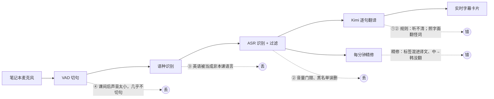

# KorASR 第三轮：翻译怪词、听不清不翻译、多语言、暂停后跟不上

2026-10-05

## 一句话总结

- **"听不清就不翻译"主要是提示词造成的。** 10 月 2 日那节课有 132/1256 句显示"（听不清）"，按模型判断其中 82% 能翻。新提示词把这批句子里的"（听不清）"从 160 句降到 5 句（§1）。
- **"莫名其妙的词"77% 来自语音识别听错了近音词**，翻译模型再照字面翻出来（비용 구조 → 비염구조 → "鼻炎结构"）。现在翻译时带约 1 分钟的前文（原话和译文），能由上下文确定原词时纠正，并用〔?〕标出（§1）。
- **"暂停后跟不上"不是变慢，而是课间后的声音太小。** 课间后是学生在讲台汇报，声音到笔记本只有 −42 到 −47 dBFS，切句的语音检测几乎不触发，三分之一能识别的讲话没上屏。暂停流程本身没有问题：本地复现结果和不暂停完全一样（§4）。
- **多语言已实现。** 每节课设"常用语言 / 偶尔出现的语言 / 显示语言"。10 月 2 日课上那段约 4 分钟的英语汇报原来 0 句显示；离线回放里新规则找回 30/48 段，同时译成中文和韩语，已有的韩语、中文句子改错 0 句（§3）。
- **界面支持中文、한국어、English、Русский**，在页面右上角切换（§5）。

## 这文档解决什么问题

你 10 月 5 日提出四个问题，并要求"不仅仅局限于这几个问题"：

1. 翻译不准确，有时出现莫名其妙的词；
2. 听不清就不翻译；只能用设备自带麦克风，要最大限度提高可用性；
3. 要支持三种或更多语言同时翻译（韩语为主，有说中文的 TA，也有说英语、俄语的同学）；
4. 暂停后继续，很长一段时间跟不上，丢很多内容。

之后又加了一条：界面只有中文，也要支持多种语言。

本文给出每个问题的原因、证据、改动和效果，以及顺带发现的其他问题。所有分析只读访问录音和数据库；付费调用只有三轮提示词 A/B 测试（每轮都由你确认并亲自运行，花费见 §7）。

**数据**：10 月 2 日课堂（session `5666bef1`，录音 159 分钟，1256 句）、9 月 29 日课堂（`97e6adda`，665 句）、9 月 28 日课堂（`d94a813b`，87 分钟，只用于样本外验证）。证据文件都在 `D:\AI\korAsr\.claude\worktrees\realtime-translation-service-7c48d5\data\eval\2026-10-05\`。这个目录只在这台电脑上，含课堂转写，已 gitignore，不进 git。下文写的相对路径都以它为起点。

**术语**：

| 术语 | 一句话解释 |
|---|---|
| ASR（Automatic Speech Recognition，语音识别） | 把声音转成文字；这里韩语用 Whisper，中文用 SenseVoice |
| VAD（Voice Activity Detection，语音活动检测） | 判断哪里有人说话，用来切句 |
| LangID（Language Identification，语种识别） | 判断这一句是哪种语言 |
| dBFS（相对满刻度分贝） | 音量单位；0 是数字音频的最大音量，越负越小声 |
| 幻觉（hallucination） | 模型没听清时编出来的句子，如"구독과 좋아요 부탁드립니다" |
| A/B 测试 | 同一批句子分别用新旧两版跑，比较结果 |
| 模型判断 | 对错由 Claude 逐句阅读后判断，不是人工听写；本文所有准确率都属于这一类 |

---

## 0. 总览

| # | 问题 | 主要原因 | 改动 | 怎么核对 |
|---|---|---|---|---|
| 1 | 怪词 | 77% 是 ASR 近音错字被照字面翻；上下文只有前 2 句 | 新提示词；前文约 1 分钟原话；课程要点作背景 | §1 |
| 2a | 听不清不翻译（翻译层） | 提示词规定"像识别错误就只输出（听不清）" | 一律翻译，没把握的词标〔?〕 | §1 |
| 2b | 听不清不翻译（识别层） | 442 句被丢：其中 124 句有内容，另有 49 句英语 | 音量门限 0.005→0.002；黑名单修正；"小声增强"开关 | §2 |
| 3 | 多语言 | 只能两种语言 | 常用 / 偶尔 / 显示语言三档 | §3 |
| 4 | 暂停后跟不上 | 课间后学生汇报太小声，VAD 不触发 | 恢复时不丢开头；音量提示；"小声增强"；英语 | §4 |
| 5 | 界面只有中文 | — | 中、韩、英、俄四种界面语言 | §5 |

---

## 1. 翻译：怪词和"（听不清）"

### 1.1 原因（10 月 2 日、9 月 29 日两节课，模型判断）

- **"（听不清）"**：两节课共 180 句。59% 完整可译，23% 部分可译，只有 18% 确实无法理解。其中 97% 是模型按旧提示词的规则直接输出的："无法理解或像是识别错误时，只输出（听不清）"。半句话和一两个错字都会触发这条规则（`translation_audit/stats.json` 的 `unclear`）。
- **译文质量**：抽检 200 句，正确 58%，小问题 24%，错误 18%。有问题的 83 句里，77% 的主因是语音识别听错了词，翻译模型照字面翻出来，比如 구독료（订阅费）→ 부동료 →"不动产"；其余主因是半句 12%、翻译本身 7%（`stats.json` 的 `sample`）。
- **加重因素**：
  - 翻译时只看前 2 句，没法用前几分钟的话纠错；
  - 两节课都没有术语表和课程材料；
  - 6 秒强制切句：韩语平均约 3.7 段才凑成一句。

### 1.2 改动

新提示词（v2）的要点：
- 一律给出译文，半句按半句译；
- 前文、课程主题能确定原词时，纠正单个近音错字并标〔?〕，确定不了就保留原文并标〔?〕；
- 不许把前文的词搬进当前句，不许编造原文没有的信息；
- 否定、条件、数字不能译反；
- 只有完全没有可辨认的词才输出"听不清"，并用目标语言写（中文"（听不清）"、韩语"（잘 안 들림）"等）。

代码侧：
- 翻译时带约 1 分钟前文（最多 8 句）和最新的本分钟要点；
- 告诉模型这一段是否被切在句子中间；
- 模型输出空行就停止生成，解释性文字不会出现在卡片上；
- 统一〔?〕写法，去掉"原文 → 译文"式回显。

### 1.3 效果：三轮 A/B（同一批 380 句，模型判断）

| | 课堂旧版 | v1 | **v2（上线）** | v3 |
|---|---|---|---|---|
| "听不清"集 180 句里仍是（听不清） | 160 | 14 | **5** | 9 |
| 相对旧版：变好 / 变差（听不清集） | — | 113 / 48 | **115 / 51** | — |
| 相对旧版：变好 / 变差（抽样 200 句） | — | 32 / 14 | **26 / 11** | — |
| 编造内容 | — | 18 | **14** | 10 |
| 解释性文字混进卡片 | — | 11 | **0** | 0 |
| 多余的"……" | — | 61 | **22** | 90 |
| 每次调用费用 | 约 ¥0.002 | ¥0.0036 | ¥0.0042 | ¥0.0033 |

核对：`translation_ab/judge/judge_stats.json`、`v2_stats.json`、`v3_stats.json`；逐句在 `*_judgments.jsonl`。

**选 v2 的理由**：三版的意思准确率在误差范围内持平（错误句 81 / 86 / 87）。v2 的格式最干净；v3 省略号过量，而且课堂旧版原本译对的句子里变差的翻倍（7 → 14）。

**剩下的问题**：
- 原文本身是乱码时，模型仍会猜错，例如"너무 차 타서"（实为 너무 착해서，"人太好"）被猜成"太忙了"。这类错误来自识别，提示词解决不了。
- 最有效的补救是课前准备术语表，把常见的误识别写法也写进去，例如"例子→粒子""시댄스→Seedance""프리미즈→previs"。

## 2. 识别层：哪些话没被识别出来

**10 月 2 日共丢弃 442 句**（整节课离线回放与线上逐句一致，1698/1698 个片段；`asr_drops/replay_summary.json`）：

| 丢在哪一步 | 句数 | 其中有内容的韩/中文（模型判断） |
|---|---|---|
| 语种识别：判为"不是本课语言" | 289 | 58（另有 48 句英语） |
| 音量低于门限 0.005 | 84 | 46（40 句是小声的中文） |
| Whisper 输出为空 | 44 | 10 |
| 低能量套话、黑名单、循环 | 25 | 10 |
| 合计 | 442 | 124（约 380 秒），另有 49 句英语 |

核对：`asr_drops/table_drops_by_reason.tsv`，逐句标注在 `labels_dropped.jsonl`。

**做了什么**：
1. **音量门限 0.005 → 0.002。** 三节课离线回放：10 月 2 日 +66 句（65% 有效、2% 错、0 幻觉），9 月 29 日 +5 句，9 月 28 日 +76 句（43% 有效、21% 错或幻觉）。找回的主要是小声的中文（同学的同步翻译、中文汇报）。核对：`asr_drops/vadgain/vadgain_table.tsv`、`vadgain_0928_table.tsv`。
2. **黑名单收窄。** 原来的"구독""좋아요"按子串拦截，10 月 2 日误删了"말씀을 드리면 구독료, 데이터센터 사용료"等真话；现在只拦完整套话（"구독과 좋아요"等）。"아멘"一律丢弃。
3. **"小声增强"开关（默认关闭）。** 只放大送给 VAD 的那份音频（门控增益，最多 +12 dB），识别和存档用的音频不变。见 §4。
4. **语种识别门限不放宽。** 四种放宽方式各找回 9–16 句，但新增的错句差不多一样多（`asr_drops/table_gate_rules.tsv`）。远场韩语单独解码时，即使语言选对也常出幻觉。

**试过、没有用的**：响度归一化、80 Hz 高通、2 kHz 高频增强都没有收益；归一化还会改变幻觉的措辞，让它绕过过滤（`asr_drops/table_processing.tsv`）。DeepFilterNet 降噪暂不尝试：当前环境装不上，而且问题主要是电平低和高频缺失，不是噪声。

**录音本身**：课堂录音 2–8 kHz（辅音所在频段）比 9 月 28 日的测试录音弱 15–19 dB；语音低于 −40 dBFS 后，音量每低 5 dB，丢弃率约翻倍（`asr_drops/band_spectrum.json`、`level_vs_drop.json`）。所以**设备位置**是最大的杠杆：汇报课把电脑放近讲台，或者用外接麦克风。

## 3. 多语言

**设置**：每节课三项。

| 设置 | 含义 | 默认 |
|---|---|---|
| 常用语言（1–2 种） | 大部分时间在说的语言，第一个是主讲语言 | 韩语、中文 |
| 偶尔出现的语言（0–2 种） | 偶尔有人说，例如英语、俄语 | 无 |
| 显示语言（1–4 种） | 要看的译文；第一个是阅读语言，要点和脉络用它写 | 中文、韩语 |

每句话先判断语种，再翻译成"显示语言里除它自己以外的每一种"。默认设置与原来的双向模式逐句一致（离线回放 384/384 个片段判定相同）。

**为什么分两档**：直接把英语、俄语和韩语、中文一视同仁，10 月 2 日会多出 146 行字幕，其中 42 行是幻觉（如 "Thank you."、"Продолжение следует..."），还会把 21 句已有的韩/中文句子改错。分档后，偶尔语言要 Whisper 概率 ≥ 0.5、至少是常用语言的 2 倍、语音 ≥ 1 秒才切换；在连续英语发言里放宽。结果：英语找回 30/48 段，新增错误 3 行，已有句子改错 0（`multilang/design.md` §8）。

**限制**：没有真实俄语录音，俄语只验证了"不会冒出幻觉"，没验证识别率。

## 4. 暂停后跟不上

| 指标 | 暂停前 96 分钟 | 恢复后 63 分钟 |
|---|---|---|
| 每分钟成功显示的字幕 | 10.1 句 | 4.6 句 |
| 一句字幕都没有的整分钟 | 4 | 15 |
| 能识别出来却没上屏的比例 | 4.3% | 32.6% |
| 每句识别耗时（中位） | 0.33 s | 0.24 s |

核对：`pause_resume/summary.json` 的 `loss_overview`、`per_connection`。

**原因**：休息后课堂变成学生在前面汇报，声音到笔记本只有 −37.8 到 −47.3 dBFS（教授讲课时 −29.7）。在 −42.5 dBFS，VAD 只有 1.5% 的块判为语音；把这一份音频放大 12 dB 后是 68%，纯噪声放大 18 dB 仍是 0%（`pause_resume/vad_gain_test.csv`）。暂停本身不是原因：本地按实时速度复现"暂停→继续"，和不暂停的结果逐句相同（15/15）。

**做了什么**：
1. **"小声增强"开关**（课堂页面，默认关）。10 月 2 日恢复后那段，找回了漏掉讲话的 38%（`asr_drops/vadgain/`，方案 GQC）。但在另一节课上，新增句约 30% 有错，所以默认关闭，在有人小声汇报、字幕出不来时手动打开。
2. **声音太小提示**：状态栏显示输入电平；讲话持续低于 −40 dBFS 时提示"把设备靠近讲话人，或换外接麦克风"。
3. **恢复时不丢开头**：点"继续"后先接上麦克风、把声音存进缓冲，连接建立后补发（端到端测试中补发了 1.5–1.8 秒）。
4. **自动跳到最新**：恢复后字幕列表回到底部；不在底部时显示"回到最新"按钮。
5. **英语汇报**由多语言功能处理（§3）。

## 5. 界面多语言

- **四种界面语言**：中文、한국어、English、Русский。
  - 顶部栏和登录页右上角都能切换；
  - 每台设备、每个浏览器各自记住自己的选择；
  - 第一次打开时，按浏览器语言自动选择。
- **范围**：所有按钮、表单、提示、状态栏、历史页、管理页和导出文件的表头。转写、译文、要点等课堂内容不翻译。
- **检查**：
  - 自动测试检查四种语言的文案键完全一致，界面代码里不再有写死的中文；
  - 四种语言在桌面（1280 px）和手机（375 px）宽度下都截图检查过，没有文字溢出。
- **注意**：韩语和俄语文案是模型翻译的，建议请母语同学看一眼。例如俄语里"精修"译成"Чистовик"，"说话人"译成"Спикер"。

## 6. 顺带发现并已修复的问题

| 问题 | 证据 | 修复 |
|---|---|---|
| 精修译文前混进"说话人3 · 韩语→中文：" | 10 月 2 日 87/455 段（19%） | 标题行与原文分行；解析时剥掉标签 |
| 精修把中→韩段落"改写"成中文 | 10 月 2 日 150 段里 57–72 段 | 检查输出语言，不合格就用实时译文 |
| 译文被存成"-" | seq 152 | 没有文字的行不算译文 |
| Kimi 账号每分钟最多 100 次请求 | A/B 首次运行收到 429 | 服务端统一限速（默认每分钟 60 次），429 自动重试 |
| 日志没有时间戳，无法算延迟 | — | 每行加时间戳；每句记录识别到翻译完成的耗时；记录浏览器采集设置 |
| 服务停了两次 | 9 月 29 日 Windows 更新重启、10 月 2 日 14:36 非正常关机 | 按你的要求不设开机自启 |

## 7. 费用

| 项目 | 数字 | 出处 |
|---|---|---|
| 三轮 A/B 实际花费 | v1 ¥1.376 + v2 ¥1.595 + v3 ¥1.261 = **¥4.23** | 按 token 用量和 kimi-k2.6 单价计算；与余额变化一致（34.38 → 30.15） |
| v2 每次逐句翻译 | ¥0.0042（输入约 780 token，其中 33% 命中缓存） | `translation_ab/stats_ab_v2.json` |
| 每节课（按 10 月 2 日 159 分钟、1256 句） | 原来约 ¥4.8，现在约 **¥7–8** | 旧版每次约 ¥0.002–0.0026 为估算 |
| 多语言 | 每句英语/俄语译成两种语言约 ¥0.005；英语占 10% 时每节课约多 ¥0.7 | `multilang/design.md` §9 |

Kimi 账号每分钟最多 100 次请求，由整个账号共用；服务端现在统一限速为每分钟 60 次。上课时不要同时跑别的 Kimi 任务。

## 8. 下一步 / 待决策

**下节课可以做的**：
1. 有学生到前面汇报时，打开"小声增强"；字幕出不来时先看状态栏的电平条，必要时把电脑挪近讲台。
2. 做一次浏览器降噪开 / 关对比，各 10 分钟。现在日志会记录浏览器和降噪设置，课后我可以比较两段的识别率。
3. 课前填术语表，把常见误识别写法也写进去。我可以根据这两节课的数据起草一份，译法需要你确认。

**待决策**：
1. **v4 提示词**：在 v2 的基础上，前文只给原话、不给译文。v3 显示这样能消除"搬运前文译文"，还能省约 17% 的翻译费用。需要再测一轮，约 ¥1.3。
2. **部署到另一台机器**：现在的启动脚本借用了另一个 conda 环境里的 cuBLAS（GPU 计算库）。换机器前需要把依赖装进 korasr 环境，并整理一份部署清单。
3. **人工抽查**：本文的对错都是模型判断。建议你抽 20–30 句听原音核对，文件在 `translation_ab/judge/v2_judgments.jsonl`。
4. **俄语**：没有真实录音。有俄语同学发言的课，录音会保存在服务器上，可以用来验证。

**没有改的**：VAD 阈值仍是 0.5（降到 0.3 改动原有句子太多）；语种识别的门限不变。
