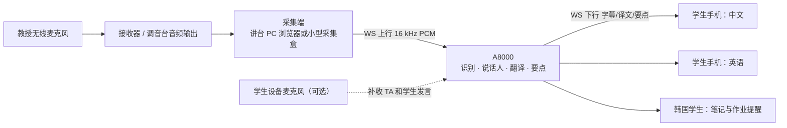

# 挑战赛企划与后续开发方向

2026-10-29

## 一句话总结

为参加 2026 DSU AI 챌린지（A 赛道，学生开发型），企划书写了五个开发方向：

1. 教室讲台麦克风统一收音，结果分发到每个学生的终端。
2. 翻译和要点改用 A8000 上的本地开源模型。
3. 给韩国学生也做课堂笔记和作业提醒。
4. 用合成语音做测试数据。
5. 最终接入学校的 e-Class。

本文记录这五个方向的设计要点和风险。现在不改线上服务。

## 这文档解决什么问题

企划书只有 1–2 页，写不下设计细节。比赛的开发期是 2026-11-16 到 12-11，共 4 周。入围后照本文开工；没入围，这五个方向仍是服务自身的路线。

申请材料（申请表、企划书草案、给主办方的邮件、证据）都放在 `D:\1_Leolee\2026-2\Files\校内AI挑战赛\`，不在仓库里。

## 比赛对开发的硬约束

| 约束 | 出处 | 对开发的影响 |
|---|---|---|
| 开发期间不得使用真实学生、教职员数据，只能用虚拟数据 | 申请表"서약"第 2 条 | 比赛开发和测试改用合成语音（方向 4）。现有课堂录音和 2026-10-05 的评测集不进比赛开发流程 |
| 资源效率 10 分：决赛演示时测 token 用量，不用外部 AI API 的作品得满分 | 申请表"API 토큰"栏 | 演示时，翻译、要点、提纲全部走本地模型（方向 2） |
| 决赛现场演示；总分里 10% 来自线上投票 | 公告 | 需要稳定的演示素材和流程 |
| 已有作品：公告没有禁止 | 公告 | 企划书把"现有原型"和"比赛期间新开发"分开写。用户决定不向主办方咨询，直接提交 |

## 方向 1：讲台麦克风统一收音，分发到多终端

**现状**：每个学生用自己设备的麦克风录音，一个 WebSocket 连接对应一节课（`backend/ws/handler.py`）。设备离教授远，声音小、噪声多。2026-10-05 的分析中，10 月 2 日那节课被识别器丢掉 442 段，其中 124 段是真实发言（`docs/2026-10-05-翻译怪词-听不清-多语言-暂停恢复.md` 第 63 行）。

**目标结构**：

**设计要点**：

1. 一节"课堂直播"由一路采集和多个只读观看者组成。观看者扫 QR 码或输入加入码进入。比赛阶段不要求账号；接入学校后改用统一登录。
2. 识别只做一次。翻译只做观看者实际选了的语言，每种语言一路，结果发给选这种语言的所有观看者。GPU 开销随教室数增长，不随学生数增长。
3. 教授控制开始和结束。讲台 PC 上的页面显示 QR 码。
4. **局限**：讲台麦克风只收到教授的声音。TA 用中文讲解、学生提问时，麦克风收不到。所以保留"个人设备麦克风"作为第二路输入，或者在教室里加一个环境麦克风。两路输入要去重并对齐时间，这部分需要单独设计。
5. 断线：采集端断线时，复用现有的暂停与恢复逻辑。观看者重连后，补发最近的字幕。
6. **待调查**：东西大学教室的无线麦克风接收器有没有音频输出口；讲台 PC 能不能接这路音频；教室网络有没有限制。

**可能改动的代码**（预估）：`backend/ws/handler.py` 拆成采集端点和观看端点；新增"房间与订阅"管理；`frontend/src/stores/session.js` 增加观看模式。

## 方向 2：翻译和要点改用本地开源模型

**为什么**：

- 资源效率能拿满分。
- 课堂音频和文字不出校。
- 没有按用量的费用。

现在每句翻译平均约 800 token（`data/eval/2026-10-05/translation_ab/stats_ab_v2.json`：输入 783.4，输出 18.6）。10 月 2 日那节课 159 分钟、1,256 句，光逐句翻译就约 100 万 token（估算：1,256 × 802）。要点和提纲的调用另算。

**候选模型**：只选许可证允许在韩国使用的。

| 模型 | 许可证 | 语言 | 结论 |
|---|---|---|---|
| Seed-X-PPO-7B | OpenMDW | 28 种，含 ko/zh/en/ru/ja，也含越南语 | 首选的翻译候选；官方建议用 PPO 版。https://huggingface.co/ByteDance-Seed/Seed-X-PPO-7B |
| Qwen3 系列 | Apache 2.0 | 多语言 | 可同时承担要点和提纲（要能遵循指令、输出 JSON）。具体大小选型时再定 |
| Hunyuan-MT-7B | Tencent Hunyuan Community License | 33 种 | **不能用**。许可证的适用地区排除韩国，在韩国使用属于未授权（License.txt 第 3、17、34 行）。https://huggingface.co/tencent/Hunyuan-MT-7B/raw/main/License.txt |
| Gemma 3 | Gemma Terms | 多语言 | 不选。fp16 下输出为空或 NaN，而 A8000 不支持 bf16。https://github.com/huggingface/transformers/issues/36822 |

**A8000 的限制**：

- Quadro RTX 8000 是 Turing 架构，没有 bf16，也没有 FlashAttention-2。模型只能用 fp16 或量化后运行。选型第一步：确认 fp16 输出正常。
- 48 GB 显存要和 Whisper large-v3、SenseVoice、说话人模型、korstudy 共用。上线前先测各进程的实际占用。
- 推理框架候选：vLLM、llama.cpp 或 Ollama（GGUF 量化）。要先确认所选版本在 Turing 上能用，再比较吞吐和首字延迟。
- 不在 A8000 生产 GPU 上做实验。先在 4090 上比较（用完即停，不常驻）。Turing 上的最终验证安排在没有课的时段。

**评测**：

- 翻译：用合成课堂脚本（方向 4）生成的句子，对照参考译文，看"听不清"率、〔?〕率、怪词抽查、延迟中位数。比赛之外的日常改进可以继续用 2026-10-05 的 380 句 A/B 集，与 Kimi v2 的输出对比。
- 要点和提纲：同一段课堂分别交给本地模型和 Kimi，人工抽查。

**退路**：要点质量不够时，先换更大的本地模型。仍不行，再申请学校发的 API key，代价是失去部分资源效率分。

## 方向 3：韩国学生也能用的功能

- **AI 课堂笔记**：已有每分钟要点和提纲（每 5 个窗口一次）。新增课后整节总结和关键术语表（`GlossaryTerm` 表已有）。
- **作业与公告提醒**：从教授的话里找出作业、截止日期和考试范围，列成清单，截止前提醒。
  - 提醒渠道候选：网页推送（PWA；iOS 要先添加到主屏幕）、导出日历文件 .ics；接入学校 App 后用 App 推送。
  - 防误报：每条提醒附原话和时间点，由学生自己确认。
- **听障学生**：只看韩语实时字幕，不需要翻译。

## 方向 4：合成语音测试数据

- **原因**：比赛规定开发期间不得使用真实师生数据。
- **做法**：
  1. 写课堂脚本：以韩语讲课为主，插入中文 TA 讲解、英语和俄语提问、作业通知。
  2. 用 TTS（Text-to-Speech，文字转语音）生成多说话人语音。
  3. 两种输入：直接送入（模拟讲台麦克风）；在教室用音箱播放、手机放远处录（模拟设备麦克风）。
  4. 脚本就是标准答案，可算 CER（Character Error Rate，字错误率），也可算作业提醒的召回率。
- TTS 要支持韩、中、英、俄、日，本地模型优先，选型时核对许可证。
- TTS 的声音比真人干净，测出的识别率会偏乐观。远场播放能部分弥补，企划书里不把它当真实课堂的成绩。

## 方向 5：接入学校系统

- **e-Class**：`eclass1.dongseo.ac.kr` 的 e-Class 入口和移动网页都指向 `canvas.dongseo.ac.kr`。canvas 的登录会跳到 eclass1 的 `xn-sso`，再回到 `/learningx/login`。据此推断是 Canvas LMS 加 LearningX。Canvas 支持 LTI 1.3（Learning Tools Interoperability，学习工具接入标准）。学校是否开放外部工具、由谁负责，要问学校。
- **统一登录**：eclass1 的登录页有"통합 로그인"。接入后用学校账号，不再单独建账号。
- **学生 App**：App Store 上有"동서대학교 스마트캠퍼스(새버전)"，功能是学生证和图书馆；没查到 Android 版。可以先放网页入口。
- 这一步属于服务化阶段（2027-01 起，学校选中后另签协议），不在 4 周开发范围内。

## 隐私与授权

- 课堂直播由教授开启，事先取得教授同意。
- 音频和文字只在校内服务器处理和保存。要定保存期限和删除方式。
- 单麦克风模式下，学生设备只接收、不录音。个人设备模式才会上传学生设备的音频。

## 风险

| 风险 | 影响 | 对策 |
|---|---|---|
| 本地模型的质量不如 Kimi k2.6 | 译文和要点变差 | 先对比再切换；要点用更大的模型；最后的退路是学校发的 key |
| 讲台麦克风收不到 TA 和学生 | 多语言课堂功能变弱 | 保留个人设备麦克风输入 |
| 教室设备的接口不明 | 第 1 周卡住 | 先向学校问清；备好 USB 声卡和线材 |
| 同类服务已有（신라대 2026-05、경남정보대 2026-03、목원대 2025-09） | 创新性得分 | 企划书写清差异：校内处理、多终端按人选语言、自动判别多种语言、给韩国学生的笔记和作业提醒 |
| 4 周工作量大 | 演示不完整 | 先做直播结构和本地模型（第 1、2 周）；作业提醒先做最小可用版 |

## 现在不做的事

- 不改 A8000 上的线上服务。本文只记录方向。
- 不在 A8000 生产 GPU 上做实验。

## 出处

- 比赛公告：https://www.dongseo.ac.kr/kr/index.php?pCode=MN2000191&mode=view&idx=103528
- 申请表模板：`D:\1_Leolee\2026-2\Files\校内AI挑战赛\原始附件\`
- 使用统计：`D:\1_Leolee\2026-2\Files\校内AI挑战赛\근거\usage_stats_2026-10-29.txt`（只读查询 A8000 的两个数据库）
- 东西大学外国留学生 1,800 余名（60 余国）：https://www.dhnews.co.kr/news/view/1065573320960834（2025-10-28）
- 同类先例：
  - 신라대：https://view.asiae.co.kr/article/2026052914024753544（2026-05-29）
  - 경남정보대：https://news.nate.com/view/20260326n30202（2026-03-26，用于入学典礼等活动）
  - 목원대：https://edaily.co.kr/News/Read?mediaCodeNo=257&newsId=03660486642295856（2025-09-01）
- 영상콘텐츠학과属于一般大学院"공학계열"：https://uni.dongseo.ac.kr/graduategeneral/
- e-Class 入口：https://eclass1.dongseo.ac.kr/
