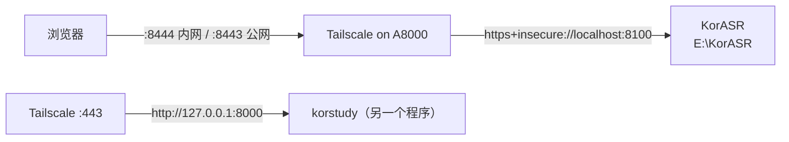

# KorASR 部署在 A8000

2026-10-15

## 一句话总结

KorASR 从 4090（日常用机）迁到了 A8000。新地址是 `https://desktop-1v7tjst.tail1447d0.ts.net:8444`（Tailscale 内网）和 `:8443`（公网）。4090 上的服务已停，转发已关，代码和数据原样保留。

## 这文档解决什么问题

记录 A8000 上的部署：东西放在哪、怎么启停、怎么更新代码、和这台机器上其他程序怎么共存。以后换机器时，照这里的步骤做。

## 机器与位置

| 项目 | 内容 |
|---|---|
| 登录 | `ssh A8000@100.95.4.120`（Windows 10，PowerShell） |
| 显卡 | Quadro RTX 8000，48 GB 显存；与 korstudy 等程序共用 |
| 代码 | `E:\KorASR`（git，`origin` 是 GitHub，当前提交从 4090 用 git bundle 带过来） |
| Python | `E:\KorASR\venv`（Python 3.12；torch 2.5.1+cu121，其余包与 4090 测过的版本一致） |
| 本机设置 | `E:\KorASR\scripts\service-env.local.cmd`（不进 git）：venv 路径、端口 8100、torch 的 CUDA 库目录、`TORCH_HOME` |
| 数据 | `E:\KorASR\data\korasr-local-test.db`（账号、课堂）、`data\raw-local-test\`（录音） |
| 模型 | `E:\KorASR\models\`（SenseVoice、说话人、分段模型，Silero VAD 代码在 `models\torch\hub`）；Whisper large-v3 用本机 Hugging Face 缓存 |
| 端口 | 8100。8000 属于 korstudy，不要动 |
| 日志 | `E:\KorASR\logs\service.log`（每行带时间） |



## 日常操作

在 A8000 上双击 `E:\KorASR` 里的 bat，或者从别的电脑通过 SSH 运行：

```powershell
ssh A8000@100.95.4.120 "cmd /c E:\KorASR\service-status.bat --no-pause"
```

```powershell
ssh A8000@100.95.4.120 "cmd /c E:\KorASR\service-stop.bat --no-pause"
```

- 通过 SSH **启动**时，服务可能随 SSH 断开一起退出。用开机任务启动更稳：

```powershell
ssh A8000@100.95.4.120 "schtasks /Run /TN \"KorASR Backend\""
```

- **开机自启**：任务"KorASR Backend"在用户登录时运行 `E:\KorASR\service-start.bat`，输出写到 `logs\autostart.out`。A8000 是服务机，所以开着；4090 上不设自启。

## 更新代码

4090 上提交后，二选一：

1. push 到 GitHub，然后在 A8000 上 `git -C E:\KorASR pull`；
2. 不 push：在 4090 上 `git bundle create korasr.bundle master`，scp 到 A8000，再 `git -C E:\KorASR fetch <bundle> master` 和 `git -C E:\KorASR merge --ff-only FETCH_HEAD`。

重启前先运行 `service-status.bat`，确认显示"没有课在录音"，并用 SQLite 在线备份复制一份数据库到 `data\backup\`。然后停掉服务、通过开机任务启动（`schtasks /Run /TN "KorASR Backend"`）。前端源码比 `frontend\dist` 新时，启动会自动重新构建。

2026-10-15 日语版本就是这样部署的（数据库备份：`E:\KorASR\data\backup\korasr-local-test-20261015-2056-pre-ja.db` 一类的文件名）。

## 迁移时做了什么（2026-10-15）

1. 两台机器回放同一段 2 分钟录音，12 句识别结果逐字相同（语种也相同）。
2. 4090 上服务已停；用 SQLite 在线备份复制数据库（19 节课、3949 句、5 个账号），录音 17 个文件 1.97 GB。
3. A8000 上启动、健康检查、通过开机任务重启，都通过。
4. 4090 的 Tailscale 只关了指向 KorASR（localhost:8000）的 :8443 和 :8444，其他程序的转发没动。

## 没有动的东西

- A8000 上的旧版 `C:\leolee\KorAsr`（5 月的代码，`data\korasr.db` 里是 5–6 月的课）原样保留，没有合并进新库。
- 4090 上的代码、数据库和录音原样保留，可以当备份。
- A8000 上的 korstudy（8000 端口、Tailscale :443）。
